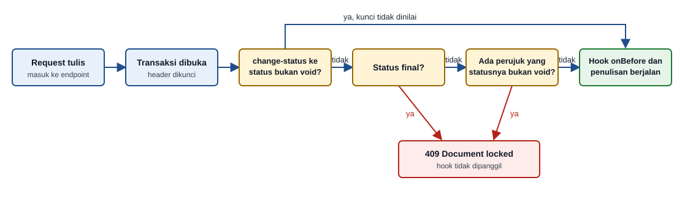

# Field Kunci Dokumen (`documentLock` dan `documentLockTargets`)

> Kunci dokumen transaksi di backend: dokumen yang final atau sudah dipakai dokumen lain menolak ubah, hapus, dan batal.

## Ikhtisar

Dua blok ini menerapkan kunci dokumen pada endpoint. `documentLock` ditulis di RDF dokumen yang dikunci, berisi aturan status dan daftar dokumen yang merujuknya. `documentLockTargets` ditulis di RDF dokumen perujuk, berisi kolom foreign key yang menunjuk dokumen lain dan cara menemukan header yang harus dikunci.

Kedua blok milik generator. `payload generate` menurunkannya dari blok [`document`](../sdf/document.md) di SDF, sehingga pengguna tidak menulisnya manual. RDF tanpa kedua blok menghasilkan endpoint yang sama persis seperti sebelumnya.

Kunci dokumen mengubah tiga hal pada endpoint.

1. Response baca memuat `is_lock`, `lock_reason`, dan `document_version`.
2. Action tulis atas dokumen terkunci dijawab `409 Document locked` sebelum hook `onBefore*` dipanggil.
3. Action tulis pada dokumen perujuk memeriksa versi dokumen yang dirujuk lewat `options.documentVersions`.

## Blok `documentLock`

Blok ini ditulis di RDF header dokumen.

```json
{
    "tableName": "purchase_order",
    "primaryKey": "purchase_order_id",
    "documentLock": {
        "statusField": "status",
        "numberField": "doc_number",
        "versionField": "row_version",
        "finalStatuses": ["received", "cancelled"],
        "voidStatuses": ["cancelled"],
        "tenantColumn": "tenant_id",
        "referrers": [
            {
                "table": "good_receipt",
                "column": "purchase_order_id",
                "references": "purchase_order_id",
                "document": {
                    "table": "good_receipt",
                    "statusField": "status",
                    "numberField": "doc_number",
                    "voidStatuses": ["cancelled"],
                    "tenantColumn": "tenant_id"
                }
            },
            {
                "via": {
                    "table": "purchase_order_item",
                    "column": "purchase_order_id",
                    "key": "purchase_order_item_id"
                },
                "table": "vendor_bill_item",
                "column": "purchase_order_item_id",
                "references": "purchase_order_item_id",
                "document": {
                    "table": "vendor_bill",
                    "column": "vendor_bill_id",
                    "references": "vendor_bill_id",
                    "statusField": "status",
                    "numberField": "doc_number",
                    "voidStatuses": ["cancelled"],
                    "tenantColumn": "tenant_id"
                }
            }
        ]
    }
}
```

### Properti `documentLock`

| Properti | Tipe | Wajib | Keterangan |
|----------|------|:-----:|-----------|
| `statusField` | string | ✓ | Kolom status dokumen. Pada bentuk header harus ada di `fieldName` |
| `numberField` | string | ✓ | Kolom nomor dokumen, dipakai pada `lock_reason` |
| `versionField` | string | ✗ | Kolom versi baris. Ditulis bila SDF mendeklarasikan `versionField` |
| `finalStatuses` | array of string | ✓ | Status yang mengunci dokumen itu sendiri |
| `voidStatuses` | array of string | ✓ | Status void. Setiap nilai harus ada di `finalStatuses` |
| `tenantColumn` | string | ✗ | Kolom tenant. Ditulis hanya pada project multi tenant, dan harus sama dengan `requestScope.column` |
| `referrers` | array of object | ✓ | Daftar dokumen yang merujuk dokumen ini. Boleh kosong |
| `partOf` | object | ✗ | Hanya pada RDF tabel baris, lihat [Bentuk Baris](#bentuk-baris-partof) |

### Properti `referrers[]`

| Properti | Tipe | Wajib | Keterangan |
|----------|------|:-----:|-----------|
| `table` | string | ✓ | Tabel yang memuat foreign key perujuk |
| `column` | string | ✓ | Kolom foreign key di `table` |
| `references` | string | ✓ | Kolom yang dirujuk |
| `via` | object | ✗ | Ditulis bila foreign key menunjuk baris dokumen, bukan header. Berisi `table` (tabel baris), `key` (kolom yang dirujuk di tabel baris), dan `column` (kolom di tabel baris yang menunjuk header) |
| `document` | object | ✓ | Header dokumen perujuk, tempat status dibaca |

Properti `document` dijelaskan di tabel berikut.

| Properti | Tipe | Wajib | Keterangan |
|----------|------|:-----:|-----------|
| `table` | string | ✓ | Tabel header perujuk |
| `statusField` | string | ✓ | Kolom status header perujuk |
| `numberField` | string | ✓ | Kolom nomor header perujuk |
| `voidStatuses` | array of string | ✓ | Status void milik dokumen perujuk |
| `column` dan `references` | string | ✗ | Join dari baris perujuk ke header-nya. Ditulis bersama, dan hanya bila perujuknya berupa baris |
| `tenantColumn` | string | ✗ | Kolom tenant header perujuk |

Pada contoh di atas, `good_receipt` merujuk header PO secara langsung. `vendor_bill_item` merujuk baris PO, sehingga `via` menjelaskan jalur dari baris PO ke header PO, dan `document.column` menjelaskan jalur dari baris tagihan ke header tagihan. Urutan `referrers` mengikuti nama tabel, dengan perujuk langsung lebih dulu dan perujuk lewat baris sesudahnya.

### Bentuk Baris (`partOf`)

RDF tabel baris dokumen yang punya endpoint sendiri mendapat `documentLock` berbentuk `partOf`. Blok ini menyalin kunci header, sehingga kunci header ikut berlaku saat baris ditambah, diubah, atau dihapus lewat endpoint baris.

```json
{
    "tableName": "purchase_order_item",
    "primaryKey": "purchase_order_item_id",
    "documentLock": {
        "partOf": {
            "table": "purchase_order",
            "column": "purchase_order_id",
            "references": "purchase_order_id"
        },
        "statusField": "status",
        "numberField": "doc_number",
        "versionField": "row_version",
        "finalStatuses": ["received", "cancelled"],
        "voidStatuses": ["cancelled"],
        "referrers": []
    }
}
```

Isi `referrers` pada contoh ini dipersingkat. Pada RDF nyata, isinya sama dengan `referrers` di RDF header.

## Blok `documentLockTargets`

Blok ini ditulis di RDF tabel yang merujuk dokumen lain. Setiap entri menjelaskan satu kolom foreign key yang menunjuk dokumen atau baris dokumen. Contoh berikut dari RDF composite `vendor_bill`.

```json
{
    "tableName": "vendor_bill",
    "primaryKey": "vendor_bill_id",
    "masterDetail": {
        "enabled": true,
        "detailTable": "vendor_bill_item",
        "foreignKey": "vendor_bill_id",
        "cascadeDelete": true
    },
    "documentLockTargets": [
        {
            "column": "purchase_order_id",
            "lockTable": "purchase_order",
            "lockKey": "purchase_order_id",
            "lockNumberColumn": "doc_number",
            "versionColumn": "row_version",
            "tenantColumn": "tenant_id"
        },
        {
            "detailTable": "vendor_bill_item",
            "column": "purchase_order_item_id",
            "via": {
                "table": "purchase_order_item",
                "key": "purchase_order_item_id",
                "column": "purchase_order_id"
            },
            "lockTable": "purchase_order",
            "lockKey": "purchase_order_id",
            "lockNumberColumn": "doc_number",
            "versionColumn": "row_version",
            "tenantColumn": "tenant_id"
        }
    ]
}
```

### Properti `documentLockTargets[]`

| Properti | Tipe | Wajib | Keterangan |
|----------|------|:-----:|-----------|
| `detailTable` | string | ✗ | Tabel detail endpoint composite. Entri tanpa `detailTable` berlaku untuk kolom di tabel RDF itu sendiri. Nilainya harus tabel detail di `masterDetail` |
| `column` | string | ✓ | Kolom foreign key. Harus ada di `fieldName` (atau di `detailConfig.fieldName` bila ada `detailTable`) |
| `via` | object | ✗ | Ditulis bila `column` menunjuk baris dokumen. Berisi `table`, `key`, dan `column` seperti pada `referrers[].via` |
| `lockTable` | string | ✓ | Tabel header yang dikunci |
| `lockKey` | string | ✓ | Primary key `lockTable`. Nilainya menjadi kunci pada `options.documentVersions` |
| `lockNumberColumn` | string | ✓ | Kolom nomor dokumen di `lockTable`, dipakai pada pesan `409 Conflict` |
| `versionColumn` | string | ✓ | Kolom versi di `lockTable`, dibandingkan dengan `options.documentVersions` |
| `tenantColumn` | string | ✗ | Kolom tenant `lockTable`. Ditulis hanya pada project multi tenant |

Entri hanya ditulis bila header tujuan menulis `versionField`, dan tidak ditulis untuk dokumen milik tabel itu sendiri. Entri ber-`detailTable` dibuat untuk tabel detail yang `partOf`-nya menunjuk tabel RDF itu. Rujukan polimorfik tanpa foreign key tidak punya entri.

## Kapan Kedua Blok Ditulis Ulang

Karena milik generator, kedua blok ditimpa setiap kali diturunkan ulang. Nilai yang disunting manual kembali seperti SDF.

| Perintah | Perilaku |
|----------|----------|
| `payload generate` | Menurunkan kedua blok. Untuk tabel detail composite, `--detail=<tabel>` ikut menurunkan entri ber-`detailTable` |
| `payload sync` | Menurunkan ulang kedua blok, termasuk saat dijalankan dengan `--expand-fk`. Bila folder SDF tidak tersedia, blok lama dibiarkan |
| `project tenant --activate` | Menurunkan ulang kedua blok pada RDF yang sudah memilikinya, sehingga `tenantColumn` tertulis bersamaan dengan `requestScope` |

Bila blok `document` dihapus dari SDF, `payload sync` menghapus `documentLock` dari RDF. Blok `concurrency` yang sudah ada tetap dipertahankan.

## Blok `concurrency` Turunan

Header dokumen yang menulis `versionField` mendapat blok [`concurrency`](./concurrency.md) dengan `versionColumn` yang sama dan `compare: "version"`. `payload generate` menulisnya bila RDF belum memilikinya.

```json
{
    "concurrency": {
        "versionColumn": "row_version",
        "compare": "version"
    }
}
```

Validator menolak `concurrency.versionColumn` yang berbeda dari `documentLock.versionField`.

## Field pada Response Baca

Action `datatables`, `read`, `first`, dan `read-composite` pada RDF ber-`documentLock` menambahkan tiga field ke setiap baris. Ketiganya dihitung server setiap kali dokumen dibaca dan tidak perlu dimasukkan ke `fieldName`. Action `lookup` hanya menambahkan `document_version`.

| Field | Tipe | Nilai |
|-------|------|-------|
| `is_lock` | boolean | `true` bila status ada di `finalStatuses`, atau ada perujuk yang statusnya bukan void |
| `lock_reason` | string atau `null` | Alasan terkunci, atau `null` bila tidak terkunci |
| `document_version` | integer atau `null` | Nilai `versionField` header. Pada RDF baris, nilainya diambil dari header baris itu. `null` bila `versionField` tidak ditulis |

Nilai `lock_reason` mengikuti aturan berikut.

| Kondisi | Nilai |
|---------|-------|
| Status final | Status dengan huruf kapital di awal setiap kata, misalnya `Received` atau `Partially Received`. Status final didahulukan atas perujuk |
| Ada perujuk aktif | `Used by <nomor>`, dengan nomor terkecil menurut urutan pengurutan database |
| Perujuk aktif hanya dari tenant lain | `Used by another document` |
| Tidak terkunci | `null` |

Tiga baris PO berikut menunjukkan nilainya.

```json
[
    {
        "doc_number": "PO-2026-0005",
        "status": "draft",
        "is_lock": false,
        "lock_reason": null,
        "document_version": 1
    },
    {
        "doc_number": "PO-2026-0007",
        "status": "ordered",
        "is_lock": true,
        "lock_reason": "Used by GR-2026-0003",
        "document_version": 3
    },
    {
        "doc_number": "PO-2026-0002",
        "status": "received",
        "is_lock": true,
        "lock_reason": "Received",
        "document_version": 5
    }
]
```

Perujuk yang berstatus void tidak mengunci. PO yang hanya dirujuk penerimaan barang berstatus `cancelled` tetap `is_lock: false`.

Perilaku baca punya beberapa catatan.

- `lock_reason` memilih nomor terkecil menurut pengurutan database. Nomor berpadding dan nomor teks bernilai sama di keempat dialect. Nomor yang hanya berbeda huruf besar dan kecil bisa berbeda: `GR-a-1` dan `GR-B-1` menghasilkan `Used by GR-a-1` di PostgreSQL dan MySQL, tetapi `Used by GR-B-1` di Oracle dan SQLite.
- `lock_reason` hanya menyebut nomor perujuk dari tenant yang sama dengan dokumen. Perujuk dari tenant lain tetap mengunci, tetapi nomornya disembunyikan.
- RDF ber-`documentLock` wajib punya primary key di `fieldName`. Bila `datatablesQuery` atau `viewQuery` ditulis eksplisit, query harus memilih primary key. `endpoint create` menolak RDF yang tidak memenuhinya.
- Cache `datatables` dan list tidak dipakai pada RDF ber-`documentLock`, karena `is_lock` bergantung pada tabel perujuk.

## Perilaku Tulis pada Dokumen Sumber

Kunci ditegakkan pada `update`, `update-composite`, `adjust`, `delete`, dan `change-status`. Setelah transaksi dibuka, header dikunci lebih dulu, lalu status dan perujuk dinilai. Dokumen terkunci dijawab `409 Document locked` sebelum hook `onBefore*` dipanggil, sehingga handler component engine tidak pernah melihat dokumen yang terkunci.



Pesan response memakai kata kerja sesuai action.

| Action | Kata kerja pada `message` |
|--------|---------------------------|
| `create` (endpoint baris) | `create` |
| `update`, `update-composite` | `update` |
| `adjust` | `adjust` |
| `delete` | `delete` |
| `change-status` | `cancel` |

```json
{
    "success": false,
    "error": "Document locked",
    "message": "Cannot update: document is locked. Used by GR-2026-0003",
    "details": {
        "is_lock": true,
        "lock_reason": "Used by GR-2026-0003"
    },
    "timestamp": "2026-10-25T09:15:00.000Z"
}
```

Aturan berbeda per action.

- `change-status` hanya menutup status tujuan yang ada di `voidStatuses`. Transisi lain tetap dinilai `workflow.transitions`, sehingga `ordered` ke `received` pada PO yang sudah dirujuk tetap berhasil. Perpindahan ke status void dijawab `409` dengan kata kerja `cancel`.
- `update` tanpa perubahan nilai pada dokumen terkunci tetap dijawab `409`, bukan `noChanges`.
- Pada RDF `softDelete` (PostgreSQL), soft delete dokumen terkunci dijawab `409`.
- `delete` pada dokumen yang tidak terkunci tetap dijaga foreign key. PO yang hanya dirujuk dokumen berstatus void bisa diubah dan dibatalkan, tetapi `delete` dijawab `409 Foreign key constraint` dengan `details.references` berisi tabel perujuknya, karena barisnya masih ada.
- Dokumen yang tidak ditemukan, atau milik tenant lain, dijawab `404` seperti biasa.

Endpoint baris (RDF dengan `documentLock` berbentuk `partOf`) menolak tambah, ubah, dan hapus baris saat header-nya terkunci.

### Kenaikan Versi

Setiap penulisan ke dokumen sumber menaikkan `versionField` header sebanyak 1. Penulisan itu mencakup `update`, `update-composite`, `adjust`, `change-status`, serta tambah, ubah, dan hapus baris lewat endpoint baris. Bila RDF juga memakai `concurrency`, versi tetap naik 1 per penulisan, bukan 2. Pembuatan dokumen perujuk tidak menaikkan versi dokumen yang dirujuk, sehingga dua penerimaan barang untuk PO yang sama tidak saling menolak.

## Sisi Perujuk

Action `create`, `update`, `create-composite`, dan `update-composite` pada RDF ber-`documentLockTargets` memeriksa dokumen yang dirujuk sebelum menulis. Pemeriksaan berjalan sebelum hook `onBefore*`.

Client mengirim versi dokumen yang dirujuk lewat `options.documentVersions`, yaitu peta dari nama `lockTable` ke peta id header dan versinya. Body memakai format `{data, options}`.

```json
{
    "data": {
        "purchase_order_id": "po_0007",
        "doc_number": "GR-2026-0003",
        "doc_date": "2026-10-25"
    },
    "options": {
        "documentVersions": {
            "purchase_order": {
                "po_0007": 3
            }
        }
    }
}
```

Pemeriksaan ini mengikuti aturan berikut.

- Versi hanya wajib untuk nilai foreign key yang baru atau berubah. `update` yang tidak mengganti foreign key tidak memerlukan versi.
- Untuk foreign key yang menunjuk baris dokumen (entri ber-`via`), kuncinya tetap id header di `lockTable`, bukan id baris.
- Versi berupa angka bulat atau string angka. Nilai lain dijawab `400`.
- Header yang dirujuk dikunci bersama, berurutan menurut nama tabel lalu primary key. Lalu versinya dibandingkan dengan versi yang dikirim.

Hasil pemeriksaan bergantung pada kondisinya.

| Kondisi | Response |
|---------|----------|
| Versi cocok | Penulisan berjalan |
| Versi tidak dikirim untuk nilai foreign key baru | `400 Bad Request` |
| Versi bukan angka bulat | `400 Bad Request` |
| Header yang dirujuk tidak ditemukan, atau milik tenant lain | `400 Foreign key constraint` dengan `code: "FOREIGN_KEY_VIOLATION"` |
| Versi berbeda dari versi header saat ini | `409 Conflict` |
| Header sedang dipakai transaksi lain dan menunggu terlalu lama | `409 Document busy` |

Versi yang tidak dikirim dijawab `400` dengan pesan berikut.

```json
{
    "success": false,
    "error": "Bad Request",
    "message": "options.documentVersions must include the version of purchase_order 'po_0007'",
    "timestamp": "2026-10-25T09:20:00.000Z"
}
```

Versi yang berbeda dijawab `409 Conflict`, dengan `details` berisi nomor dokumen dan kedua versi.

```json
{
    "success": false,
    "error": "Conflict",
    "message": "The referenced document PO-2026-0007 was modified by another user after you opened it.",
    "details": {
        "table": "purchase_order",
        "id": "po_0007",
        "doc_number": "PO-2026-0007",
        "expectedVersion": 3,
        "currentVersion": 4
    },
    "timestamp": "2026-10-25T09:20:00.000Z"
}
```

Bila header tidak ditemukan atau milik tenant lain, `details` memuat nama kolom foreign key.

```json
{
    "success": false,
    "error": "Foreign key constraint",
    "code": "FOREIGN_KEY_VIOLATION",
    "message": "Referenced data not found",
    "details": {
        "purchase_order_id": ["Referenced data not found"]
    },
    "timestamp": "2026-10-25T09:20:00.000Z"
}
```

Response `409 Document busy` dipakai saat dua transaksi saling menunggu (deadlock) atau menunggu kunci melewati batas waktu database.

```json
{
    "success": false,
    "error": "Document busy",
    "message": "Document is being modified by another request. Please retry.",
    "timestamp": "2026-10-25T09:20:00.000Z"
}
```

Dua request yang sama-sama menunggu header tidak pernah menyimpan dokumen perujuk yang merujuk versi lama. Bila Edit PO selesai lebih dulu, perujuk dijawab `409 Conflict`. Bila perujuk tersimpan lebih dulu, Edit PO dijawab `409 Document locked`.

Nilai foreign key yang diisi hook `onBefore*` tidak ikut dikunci, karena pemeriksaan berjalan sebelum hook.

## Multi Tenant

Aturan tenant berlaku bila RDF punya `requestScope` dan entri kunci memuat `tenantColumn`.

- Kunci di dokumen sumber memakai filter `requestScope` yang sama dengan action tulis. Dokumen tenant lain dijawab `404`.
- Kunci di dokumen perujuk ikut disaring `requestScope`, kecuali untuk user dengan role di `bypassRoles`. Dokumen tujuan milik tenant lain dijawab `400 FOREIGN_KEY_VIOLATION`, dan dokumen itu tidak ikut terkunci.
- Pemeriksaan perujuk tidak disaring tenant. Perujuk lintas tenant yang sudah ada tetap mengunci dokumen, dengan `lock_reason` bernilai `Used by another document`.

Validator menolak `requestScope` yang disertai `documentLock` tanpa `tenantColumn`. Jalankan `payload generate` ulang untuk menurunkannya.

## Perbedaan Antardialect

Kontrak response sama di PostgreSQL, MySQL, Oracle, dan SQLite. Perbedaan yang terasa pengguna ada di tabel berikut.

| Aspek | PostgreSQL | MySQL | Oracle | SQLite |
|-------|------------|-------|--------|--------|
| Dua dokumen perujuk untuk dokumen yang sama | Diproses bersamaan | Diproses bersamaan | Diproses bergantian | Diproses bergantian |
| Penyebab `409 Document busy` | Deadlock atau lock timeout | Deadlock atau lock wait timeout | Deadlock | Menunggu lebih lama dari `DB_BUSY_TIMEOUT` (default 5000 ms) |

Pada SQLite, request tulis diproses satu per satu. Pada Oracle, dua penerimaan barang untuk PO yang sama berjalan bergantian selama satu transaksi tulis. Pembacaan tidak terpengaruh di kedua dialect.

## Aturan Validasi

Dijalankan oleh `payload validate` dan `endpoint create`. Pesan memakai pola `<lokasi> in <file> <aturan>`.

| Aturan | Pesan Error |
|--------|-------------|
| `documentLock` harus object | `documentLock in <file> must be a non-null object` |
| Key wajib hilang | `documentLock.<key> in <file> is required` |
| Kolom bukan identifier polos | `documentLock.<key> in <file> must be a plain column identifier (found <nilai>)` |
| Daftar status tidak valid | `documentLock.<key> in <file> must be a non-empty array of non-empty strings` |
| `statusField` (bentuk header) harus ada di `fieldName` | `documentLock.statusField in <file> references '<field>' which is not in fieldName` |
| `voidStatuses` harus bagian dari `finalStatuses` | `documentLock.voidStatuses[<i>] in <file> '<status>' is not in documentLock.finalStatuses` |
| `referrers` harus array | `documentLock.referrers in <file> is required and must be an array` |
| `column` dan `references` di `document` ditulis bersama | `documentLock.referrers[<i>].document in <file> must declare 'column' and 'references' together` |
| `concurrency.versionColumn` sama dengan `versionField` | `concurrency.versionColumn in <file> '<kolom>' must equal documentLock.versionField '<field>'` |
| `tenantColumn` sama dengan `requestScope.column` | `documentLock.tenantColumn in <file> '<kolom>' must equal requestScope.column '<kolom scope>'` |
| `tenantColumn` wajib bila ada `requestScope` | `documentLock.tenantColumn in <file> is required because requestScope.column is '<kolom>'; run 'payload generate' again to derive it` |
| `documentLockTargets` harus array tidak kosong | `documentLockTargets in <file> must be a non-empty array` |
| `column` (tanpa `detailTable`) harus ada di `fieldName` | `documentLockTargets[<i>].column in <file> references '<kolom>' which is not in fieldName` |
| `detailTable` harus tabel detail di `masterDetail` | `documentLockTargets[<i>].detailTable in <file> '<tabel>' is not a detail table in masterDetail` |
| `column` (dengan `detailTable`) harus ada di `detailConfig.fieldName` | `documentLockTargets[<i>].column in <file> references '<kolom>' which is not in detailConfig.fieldName of '<tabel>'` |
| `tenantColumn` entri sama dengan `requestScope.column` | `documentLockTargets[<i>].tenantColumn in <file> '<kolom>' must equal requestScope.column '<kolom scope>'` |

Key yang tidak dikenal menghasilkan warning, bukan error. `endpoint create` juga berhenti sebelum menulis file apa pun bila primary key tidak ada di `fieldName` atau tidak dipilih oleh `datatablesQuery` dan `viewQuery` eksplisit.

## Batasan

- Delete tetap dijaga foreign key, sehingga perujuk berstatus void tidak membuka `Delete`.
- Nilai foreign key yang diisi hook `onBefore*` tidak dikunci.
- Foreign key lintas tenant pada `create` dan `create-composite` di luar `documentLockTargets` tidak disaring tenant.

---

**Lihat juga**: [`concurrency.md`](./concurrency.md) · [`workflow.md`](./workflow.md) · [`master-detail.md`](./master-detail.md) · [`../sdf/document.md`](../sdf/document.md) · [`../udf/document-lock.md`](../udf/document-lock.md) · [`rdf/`](./) · [`catalogs/`](../) · [`README`](../../README.md)
