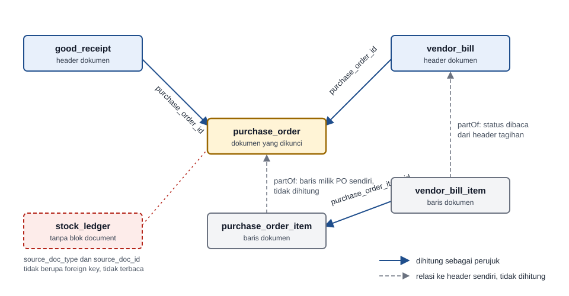

# Definisi Dokumen Transaksi (`document`)

> Blok di level model yang menandai tabel sebagai header atau baris dokumen transaksi, sebagai dasar kunci dokumen di backend dan frontend.

## Ikhtisar

Blok `document` menyatakan bahwa tabel itu adalah dokumen transaksi, misalnya purchase order atau penerimaan barang. Dari blok ini RESTForge menurunkan kunci dokumen. Dokumen yang statusnya sudah final, atau yang sudah dipakai dokumen lain, menolak `Edit`, `Delete`, dan `Cancel`.

Blok ini tidak mengubah DDL. Tabel tanpa blok `document`, termasuk tabel master, berjalan persis seperti sebelumnya: penghapusan ditahan foreign key dan jalan keluarnya `Deactivate`.

SDF hanya mendeklarasikan struktur dokumen. Aturan yang dijalankan di backend ditulis `payload generate` ke RDF sebagai [`documentLock` dan `documentLockTargets`](../rdf/document-lock.md), lalu `payload migrate` menurunkan perilaku tombol di UDF lewat [`documentLock`](../udf/document-lock.md).

## Dua Bentuk Blok

Satu tabel memakai salah satu dari dua bentuk berikut. Header dokumen menulis kolom status, nomor, dan aturan statusnya.

```javascript
document: {
  statusField: 'status',
  numberField: 'doc_number',
  versionField: 'row_version',
  finalStatuses: ['received', 'cancelled'],
  voidStatuses: ['cancelled']
}
```

Tabel baris dokumen hanya menulis `partOf`, yaitu nama relasi `belongsTo` yang menunjuk ke header-nya.

```javascript
document: {
  partOf: 'header'
}
```

## Properti

| Properti | Tipe | Bentuk | Wajib | Keterangan |
|----------|------|--------|:-----:|-----------|
| `statusField` | string | Header | ✓ | Nama field status dokumen. Harus ada di `fields` |
| `numberField` | string | Header | ✓ | Nama field nomor dokumen. Harus ada di `fields`. Nilainya muncul pada pesan `Used by <nomor>` |
| `finalStatuses` | array of string | Header | ✓ | Status yang mengunci dokumen itu sendiri, misalnya `received` dan `cancelled` |
| `voidStatuses` | array of string | Header | ✓ | Status yang membuat dokumen tidak dihitung sebagai perujuk. Status tujuan inilah yang ditutup saat dokumen terkunci. Harus bagian dari `finalStatuses` |
| `versionField` | string | Header | Bersyarat | Field versi baris, bertipe `integer notnull`. Wajib bila dokumen dirujuk dokumen lain |
| `partOf` | string | Baris | ✓ | Nama relasi `belongsTo` di tabel ini yang target-nya header dokumen |

Status final dan status void punya peran berbeda. Status final mengunci dokumennya sendiri. Status void menentukan perujuk mana yang tidak dihitung. Pada alur purchasing, `received` hanya final, sedangkan `cancelled` final sekaligus void.

## Aturan Validasi

Pelanggaran aturan 1 sampai 7 dilaporkan saat file schema dimuat, dengan awalan `Failed to load schema file '<file>':`. Aturan 8 dilaporkan `schema validate` sebagai masalah lintas model. Pada tabel ber-schema, `<table>` ditulis dalam bentuk `schema.tabel`.

| No | Aturan | Pesan Error |
|----|--------|-------------|
| 1 | Hanya salah satu bentuk yang dipakai, yaitu header atau `partOf` | `document in <table> must declare either statusField or partOf, not both` |
| 2 | `statusField` dan `numberField` ada di `fields` | `document.statusField '<field>' in <table> is not a field` |
| 3 | `finalStatuses` dan `voidStatuses` berupa array string tidak kosong | `document.finalStatuses in <table> must be a non-empty array of strings` |
| 4 | `voidStatuses` bagian dari `finalStatuses` | `document.voidStatuses '<status>' in <table> must also be listed in finalStatuses` |
| 5 | Bila kolom status punya CHECK `in`, semua status yang ditulis ada di daftar CHECK | `document.finalStatuses '<status>' in <table> is not allowed by the CHECK on '<field>'` |
| 6 | `partOf` menunjuk relasi `belongsTo` yang target-nya punya blok `document` bentuk header | `document.partOf '<relation>' in <table> must name a belongsTo relation to a document table` |
| 7 | `versionField` ada di `fields` dan bertipe `integer notnull` | `document.versionField '<field>' in <table> must be an integer notnull field` |
| 8 | Header yang dirujuk dokumen lain wajib menulis `versionField` | `document.versionField in <table> is required because <referrer table> references it as a document` |

Beberapa kasus lain ikut ditolak. Key di luar yang dikenal dijawab `document.<key> in <table> is not a recognized key`, dan bentuk `partOf` tidak boleh memuat key lain. Header tanpa `numberField` dijawab `document.numberField in <table> is required`.

## Perujuk yang Dihitung

Dokumen D dirujuk oleh relasi `belongsTo` dari tabel lain ke header D atau ke tabel baris D. Relasi dihitung sebagai perujuk hanya bila tabel asalnya punya blok `document`, baik sebagai header maupun sebagai baris. Relasi dari header D sendiri dan dari baris milik D tidak dihitung.

Status perujuk dibaca dari header dokumen perujuk. Untuk perujuk berupa baris, `payload generate` menyusun join dari baris ke header-nya lewat relasi `partOf`. Perujuk mengunci bila statusnya tidak ada di `voidStatuses` milik dokumen perujuk itu sendiri.



Rujukan polimorfik tanpa foreign key tidak dihitung. Contohnya `stock_ledger` yang menunjuk dokumen asal lewat pasangan kolom `source_doc_type` dan `source_doc_id`. Pasangan kolom itu tidak menyatakan tabel tujuan, sehingga tidak ada relasi `belongsTo` yang bisa dibaca. Tabel efek posting yang memakai foreign key pun tidak dihitung selama tidak punya blok `document`.

## Contoh Purchasing

Contoh berikut memakai alur pembelian. PO dirujuk header penerimaan barang, header tagihan vendor, dan baris tagihan vendor. Kolom yang tidak memengaruhi kunci dokumen tidak ditampilkan.

Header PO menulis blok lengkap dengan `versionField`, karena PO dirujuk dokumen lain.

```javascript
// schema/purchase_order.js
module.exports = ({ defineModel }) => defineModel('purchase_order', {
  fields: {
    purchase_order_id: 'string:36 pk',
    doc_number:        'string:32 notnull',
    doc_date:          'date notnull',
    status:            "string:20 notnull default:'draft'",
    row_version:       'integer notnull default:1'
  },
  checks: [
    { field: 'status', in: ['draft', 'ordered', 'partially_received', 'received', 'cancelled'] }
  ],
  document: {
    statusField: 'status',
    numberField: 'doc_number',
    versionField: 'row_version',
    finalStatuses: ['received', 'cancelled'],
    voidStatuses: ['cancelled']
  }
});
```

Baris PO hanya menunjuk relasi header-nya.

```javascript
// schema/purchase_order_item.js
module.exports = ({ defineModel }) => defineModel('purchase_order_item', {
  fields: {
    purchase_order_item_id: 'string:36 pk',
    purchase_order_id:      'string:36 notnull',
    line_number:            'integer notnull',
    quantity:               'decimal:18,6 notnull'
  },
  document: {
    partOf: 'header'
  },
  relations: {
    header: {
      type: 'belongsTo',
      target: 'purchase_order',
      localKey: 'purchase_order_id',
      references: 'purchase_order_id',
      onDelete: 'cascade'
    }
  }
});
```

Penerimaan barang merujuk PO lewat `purchase_order_id` di header. Kolom ini boleh kosong karena penerimaan tanpa PO tetap sah, dan relasinya tetap dihitung sebagai perujuk bila terisi. Penerimaan barang juga menulis `versionField`, karena barisnya dirujuk baris tagihan vendor.

```javascript
// schema/good_receipt.js
module.exports = ({ defineModel }) => defineModel('good_receipt', {
  fields: {
    good_receipt_id:   'string:36 pk',
    doc_number:        'string:32 notnull',
    status:            "string:20 notnull default:'draft'",
    purchase_order_id: 'string:36',
    row_version:       'integer notnull default:1'
  },
  checks: [
    { field: 'status', in: ['draft', 'waiting_approval', 'posted', 'cancelled'] }
  ],
  document: {
    statusField: 'status',
    numberField: 'doc_number',
    versionField: 'row_version',
    finalStatuses: ['posted', 'cancelled'],
    voidStatuses: ['cancelled']
  },
  relations: {
    purchaseOrder: {
      type: 'belongsTo',
      target: 'purchase_order',
      localKey: 'purchase_order_id',
      references: 'purchase_order_id',
      onDelete: 'restrict'
    }
  }
});
```

Baris tagihan vendor merujuk baris PO, sehingga tagihan vendor menjadi perujuk PO lewat baris. Tagihan vendor tidak dirujuk dokumen lain, sehingga header-nya tidak wajib menulis `versionField`.

```javascript
// schema/vendor_bill_item.js
module.exports = ({ defineModel }) => defineModel('vendor_bill_item', {
  fields: {
    vendor_bill_item_id:    'string:36 pk',
    vendor_bill_id:         'string:36 notnull',
    purchase_order_item_id: 'string:36',
    quantity:               'decimal:18,6 notnull'
  },
  document: {
    partOf: 'header'
  },
  relations: {
    header: {
      type: 'belongsTo',
      target: 'vendor_bill',
      localKey: 'vendor_bill_id',
      references: 'vendor_bill_id',
      onDelete: 'cascade'
    },
    poItem: {
      type: 'belongsTo',
      target: 'purchase_order_item',
      localKey: 'purchase_order_item_id',
      references: 'purchase_order_item_id',
      onDelete: 'restrict'
    }
  }
});
```

Pada project `TENANT_MODE=multi`, kolom tenant tidak ditulis di SDF. `schema migrate` menambahkannya ke tabel, dan nama kolomnya muncul sebagai `tenantColumn` di RDF.

## Bantuan di CLI

Section `document` tersedia di katalog dbschema, termasuk delapan aturan di atas.

```bat
npx restforge catalog dbschema --section=document
```

## Batasan

- Blok `document` hanya menandai struktur. Kunci dokumen berlaku di backend setelah `payload generate` menulis [`documentLock`](../rdf/document-lock.md) ke RDF dan `endpoint create` dijalankan.
- Delete tetap dijaga foreign key. Perujuk yang berstatus void tidak lagi mengunci dokumen, tetapi barisnya masih ada sehingga foreign key `restrict` tetap menolak `Delete`.

---

**Lihat juga**: [`relations.md`](./relations.md) · [`foreign-keys.md`](./foreign-keys.md) · [`check-constraints.md`](./check-constraints.md) · [`sdf/`](./) · [`catalogs/`](../) · [`README`](../../README.md)
