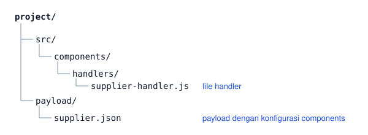

# Component Engine

Component Engine berfungsi untuk menjalankan custom logic secara otomatis sebelum dan sesudah operasi CRUD, melalui handler yang didaftarkan di payload JSON.

Event `onBefore*` dan `onAfter*` berjalan di dalam transaksi operasi utama dan berperilaku seperti database trigger. Jika handler gagal, seluruh transaction di-rollback, termasuk data yang ditulis handler lewat `services.db`. Efek samping ke luar sistem, seperti email atau webhook, ditulis di event `onAfterCommit*` yang baru berjalan setelah data tersimpan. Konfigurasi dilakukan sepenuhnya secara deklaratif, tanpa modifikasi code runtime.

---

## Mendaftarkan Handler di Payload

Tambahkan property `components` di payload JSON untuk mendaftarkan handler pada sebuah tabel.

```json
{
  "tableName": "supplier",
  "primaryKey": "supplier_id",
  "fieldName": ["supplier_id", "supplier_code", "supplier_name"],
  "action": { "create": true, "update": true, "delete": true },
  "components": [
    {
      "properties": {
        "filename": "components/handlers/supplier-handler.js",
        "methods": [
          {
            "name": "validateBeforeInsert",
            "events": "onBeforeInsert",
            "params": [
              { "value": "{tableName}" },
              { "value": "{requestData}" },
              { "value": "{oldData}" },
              { "value": "{newData}" }
            ]
          },
          {
            "name": "syncAfterUpdate",
            "events": "onAfterUpdate",
            "params": [
              { "value": "{tableName}" },
              { "value": "{requestData}" },
              { "value": "{oldData}" },
              { "value": "{newData}" }
            ]
          }
        ]
      }
    }
  ]
}
```

Setelah payload diperbarui, lakukan regenerate module dan restart runtime.

> **Perlu diketahui:** Jika payload tidak memiliki property `components`, semua operasi CRUD berjalan normal tanpa event. Tidak ada perubahan behavior pada modul yang sudah ada.

### Event yang Tersedia

| Event | Dipanggil |
|-------|-----------|
| `onBeforeInsert` | Sebelum INSERT — `oldData` null, `newData` null |
| `onAfterInsert` | Setelah INSERT — `oldData` null, `newData` berisi record baru |
| `onBeforeUpdate` | Sebelum UPDATE — `oldData` berisi data lama, `newData` null |
| `onAfterUpdate` | Setelah UPDATE — `oldData` berisi data lama, `newData` berisi data baru |
| `onBeforeDelete` | Sebelum DELETE — `oldData` berisi data lama, `newData` null |
| `onAfterDelete` | Setelah DELETE — `oldData` berisi data lama, `newData` null |
| `onAfterCommitInsert` | Setelah INSERT tersimpan, dengan context yang sama seperti `onAfterInsert` |
| `onAfterCommitUpdate` | Setelah UPDATE tersimpan, dengan context yang sama seperti `onAfterUpdate` |
| `onAfterCommitDelete` | Setelah DELETE tersimpan, dengan context yang sama seperti `onAfterDelete` |

Endpoint `/adjust` dan `/change-status` memakai pola nama yang sama, yaitu `onBeforeAdjust`, `onAfterAdjust`, dan `onAfterCommitAdjust`, serta `onBeforeWorkflow`, `onAfterWorkflow`, dan `onAfterCommitWorkflow`.

### Template Variable

Parameter `params` menggunakan template variable yang di-resolve dari context request.

| Variable | Isi |
|----------|-----|
| `{tableName}` | Nama tabel yang sedang dioperasikan |
| `{requestData}` | Data dari request body (`req.body`) |
| `{oldData}` | Data sebelum operasi. `null` untuk INSERT |
| `{newData}` | Data setelah operasi. `null` untuk onBefore dan DELETE |
| `{operation}` | Tipe operasi: `INSERT`, `UPDATE`, atau `DELETE` |
| `{user_id}` | User ID dari request header |
| `{timestamp}` | ISO timestamp saat event dieksekusi |
| `{record_id}` | Primary key record yang dioperasikan |

---

## Menulis File Handler

Letakkan file handler di `src/components/handlers/` pada folder project. Component engine akan melakukan `require()` secara otomatis saat server startup, tanpa registrasi tambahan.



Setiap function handler menerima lima parameter, dengan `services` di-inject secara otomatis sebagai parameter terakhir.

```js
async function validateBeforeInsert(table_name, request_data, old_data, new_data, services) {
  const { db, logger } = services;

  if (!request_data.supplier_code) {
    return { success: false, message: 'Supplier code wajib diisi' };
  }

  logger.info({ table: table_name }, 'Validation passed');
  return { success: true };
}

module.exports = { validateBeforeInsert };
```

### Return Value

Handler wajib mengembalikan object dengan property `success`.

```js
// Lanjutkan operasi
return { success: true };

// Lanjutkan operasi dan tentukan nilai field yang disimpan (onBeforeInsert, onBeforeUpdate)
return { success: true, data: { kode: 'P001' } };

// Rollback transaction dan kembalikan error ke client
return { success: false, message: 'Supplier masih memiliki purchase order aktif' };
```

> **Perlu diketahui:** `return { success: false }` berlaku sama untuk onBefore maupun onAfter — keduanya menyebabkan rollback seluruh transaction. Exception yang tidak tertangkap di dalam handler juga memicu rollback.

Client menerima HTTP 400 dengan `message` berisi pesan dari handler saja. Untuk exception, `message` berisi pesan exception tersebut. Nama event, nama fungsi, dan path file handler hanya ditulis ke log server, misalnya `onBeforeInsert failed: Handler validateBeforeInsert (components/handlers/supplier-handler.js, table supplier) failed: Supplier code wajib diisi`. Pada endpoint `change-status`, field `error` bernilai `Workflow hook rejected`. Endpoint lain memakai `Bad Request`.

### Mendaftarkan Beberapa Handler pada Satu Event

Untuk mendaftarkan beberapa handler pada satu event, tambahkan item di array `methods` dalam urutan eksekusi yang diinginkan.

```json
"methods": [
  { "name": "validateStock", "events": "onBeforeInsert", "params": [...] },
  { "name": "auditLog",      "events": "onBeforeInsert", "params": [...] }
]
```

Handler dieksekusi secara berurutan. Jika handler pertama mengembalikan `{ success: false }`, handler berikutnya tidak dieksekusi.

---

## Mengakses Services di Handler

Component engine meng-inject object `services` sebagai parameter terakhir secara otomatis, tanpa perubahan konfigurasi payload.

```js
async function myHandler(table_name, request_data, old_data, new_data, services) {
  const { db, logger, redis, kafka, cache } = services;

  // Query ke tabel lain
  const result = await db.executeQuery(
    'SELECT COUNT(*) AS total FROM purchase_order WHERE supplier_id = $1',
    [old_data.supplier_id]
  );

  logger.info({ total: result[0].total }, 'Dependency check');
  return { success: true };
}
```

| Service | Key | Tersedia |
|---------|-----|----------|
| Database | `db` | Selalu. Auto-route berdasarkan `DB_TYPE` (PostgreSQL, MySQL, Oracle, SQLite). Di `onBefore*` dan `onAfter*` ikut transaksi operasi utama |
| Database independen | `dbIndependent` | Selalu. Memakai koneksi terpisah dari transaksi operasi utama |
| Logger | `logger` | Selalu. Fallback ke `console` jika pino tidak tersedia |
| Redis | `redis` | `null` jika Redis tidak dikonfigurasi |
| Kafka | `kafka` | `null` jika `KAFKA_ENABLED` bukan `'true'` |
| Cache | `cache` | `null` jika cache tidak dikonfigurasi |

> **Perlu diketahui:** Service opsional (`redis`, `kafka`, `cache`) bernilai `null` jika tidak dikonfigurasi. Lakukan null-check sebelum menggunakannya. Handler lama yang tidak mendeklarasikan parameter `services` tetap berfungsi normal karena JavaScript mengabaikan argumen ekstra.

---

## Menulis ke Database dari Handler

Di event `onBefore*` dan `onAfter*`, `services.db` menjalankan query di transaksi yang sama dengan INSERT, UPDATE, atau DELETE utama. Pemesanan stok, misalnya, bisa mengunci baris stok di `onBeforeInsert` lalu mengurangi jumlahnya di `onAfterInsert`, dan keduanya tersimpan atau dibatalkan bersama data pesanan.

```js
async function cekStok(table_name, request_data, old_data, new_data, services) {
  const rows = await services.db.executeQuery(
    'SELECT qty FROM stok WHERE item_id = $1 FOR UPDATE',
    [request_data.item_id]
  );
  if (!rows[0] || rows[0].qty < request_data.qty) {
    return { success: false, message: 'Stok tidak cukup' };
  }
  return { success: true };
}

async function kurangiStok(table_name, request_data, old_data, new_data, services) {
  await services.db.executeQuery(
    'UPDATE stok SET qty = qty - $1 WHERE item_id = $2',
    [request_data.qty, request_data.item_id]
  );
  return { success: true };
}
```

Cara memanggil `services.db` di dalam transaksi sama seperti biasa, termasuk placeholder per dialect (`$1` di PostgreSQL, `?` di MySQL dan SQLite, `:1` di Oracle). Commit dan rollback diatur runtime, sehingga handler tidak memanggilnya sendiri. `executeTransaction(queries)` di dalam handler berjalan sebagai bagian dari transaksi utama, dan bila salah satu query gagal hanya query di dalam pemanggilan itu yang dibatalkan. Setelah event selesai, `services.db` tidak bisa dipakai lagi, sehingga query dari promise yang tidak di-`await` atau dari `setTimeout` ditolak dengan error `services.db is bound to a finished transaction`.

Beberapa data justru harus tetap tersimpan walau operasi utama gagal, misalnya log percobaan yang ditolak. Data seperti ini ditulis lewat `services.dbIndependent`, seperti contoh berikut.

```js
async function cekKuota(table_name, request_data, old_data, new_data, services) {
  const { db, dbIndependent } = services;
  const rows = await db.executeQuery('SELECT sisa FROM kuota WHERE member_id = $1', [request_data.member_id]);
  if (rows[0].sisa <= 0) {
    // Tetap tersimpan walau operasi dibatalkan
    await dbIndependent.executeQuery('INSERT INTO log_tolak (member_id) VALUES ($1)', [request_data.member_id]);
    return { success: false, message: 'Kuota habis' };
  }
  return { success: true };
}
```

Bila seluruh query satu handler memang harus terpisah dari transaksi utama, method handler tersebut diberi `"transaction": "independent"` di payload. Dengan begitu `services.db` milik handler itu memakai koneksi terpisah.

```json
{ "name": "catatPercobaan", "events": "onBeforeInsert", "transaction": "independent", "params": [...] }
```

> **Perlu diketahui:** SQLite hanya memakai satu koneksi, sehingga di SQLite `services.dbIndependent` dan `"transaction": "independent"` tetap ikut dibatalkan bersama operasi utama.

---

## Mengisi Nilai Field dari Handler

Nomor dokumen, tanggal jatuh tempo, dan nilai turunan lain sebaiknya dihitung server, bukan dikirim client. Handler `onBeforeInsert` dan `onBeforeUpdate` menentukan nilai itu dengan mengembalikan `{ success: true, data: { <field>: <nilai> } }`. Field yang tidak disebut di `data` tetap memakai nilai dari client.

```js
async function isiNomorPinjam(table_name, request_data, old_data, new_data, services) {
  const { db } = services;
  await db.executeQuery('LOCK TABLE peminjaman IN SHARE ROW EXCLUSIVE MODE');
  const [row] = await db.executeQuery(
    `SELECT COALESCE(MAX(SUBSTRING(kode FROM 2)::int), 0) + 1 AS berikut,
            to_char(CURRENT_DATE + 7, 'YYYY-MM-DD') AS jatuh_tempo
       FROM peminjaman`
  );
  return {
    success: true,
    data: {
      kode: `P${String(row.berikut).padStart(3, '0')}`,
      jatuh_tempo: row.jatuh_tempo
    }
  };
}
```

INSERT atau UPDATE utama disusun setelah semua handler `onBefore*` selesai, di dalam transaksi yang sama. Karena itu nomor di atas dibaca dan disimpan tanpa celah untuk request lain. Nilai dari handler diperlakukan seperti nilai dari client, dengan beberapa aturan tambahan.

- Bila ada beberapa handler, isi `data` digabung sesuai urutan, dan handler berikutnya sudah melihat hasil handler sebelumnya di `{requestData}`.
- Field yang bukan kolom tabel dan kolom audit (`created_at`, `updated_by`, dan sejenisnya) diabaikan, lalu dicatat sebagai peringatan di log server.
- Primary key boleh diisi saat insert. Mengubah primary key saat update ditolak dengan HTTP 400.
- Nilai dari handler divalidasi dengan aturan `fieldValidation` yang sama. Nilai yang melanggar dibalas HTTP 400 `VALIDATION_FAILED`, dan seluruh operasi dibatalkan.
- Response `/create` dan `/update` menampilkan nilai yang benar-benar tersimpan, dan `{requestData}` di event `onAfter*` sudah memuat nilai dari handler.

Field yang wajib ada tetapi selalu dihitung handler diberi constraint `"filledByHook": true` di samping `"required": true`. Client tidak perlu mengirim field tersebut, dan request tetap ditolak bila handler lupa mengisinya. Detailnya ada di [field validation](../../catalogs/rdf/field-validation.md#field-yang-diisi-handler-filledbyhook).

```json
{ "name": "kode", "type": "string", "constraints": { "primaryKey": true, "required": true, "filledByHook": true, "pattern": "^P[0-9]{3}$" } }
```

> **Perlu diketahui:** Mengubah object `request_data` secara langsung tidak ikut tersimpan. Nilai hanya diambil dari `data` yang dikembalikan handler. Kolom tanggal dikirim sebagai string, misalnya `2026-10-20`, bukan object `Date`.

---

## Menjalankan Efek Samping Setelah Data Tersimpan

Email, WhatsApp, webhook, publish Kafka, atau penghapusan file di storage hanya boleh terjadi bila data benar-benar tersimpan. Pekerjaan seperti ini didaftarkan di event `onAfterCommit*`, yang dipanggil setelah COMMIT berhasil dengan context yang sama seperti event `onAfter*`. Bila operasi dibatalkan, handler `onAfterCommit*` tidak dipanggil.

```json
{
  "name": "kirimNotifikasi",
  "events": "onAfterCommitInsert",
  "params": [
    { "value": "{tableName}" },
    { "value": "{newData}" }
  ]
}
```

Event ini tidak blocking. Handler yang mengembalikan `{ success: false }` atau melempar exception hanya dicatat di log server, handler berikutnya tetap dijalankan, dan client tetap menerima response sukses. Di event ini `services.db` memakai koneksi terpisah karena transaksi utama sudah selesai.

Penulisan ke database atau layanan lain yang harus selalu sejalan dengan data utama tidak bisa dibuat atomik dalam satu transaksi. Simpan pesannya ke tabel antrean (outbox) lewat `services.db` di `onAfter*`, lalu kirim isi antrean dari `onAfterCommit*` atau dari job terpisah.

---

## Memakai Event Composite

Event composite tersedia untuk operasi `/create-composite` dan `/update-composite`. Event ini menggunakan nama berbeda dari event single table untuk menghindari ambiguitas context.

| Event | Dipanggil |
|-------|-----------|
| `onBeforeCompositeInsert` | Sebelum composite INSERT — menerima header + detail items |
| `onAfterCompositeInsert` | Setelah composite INSERT — menerima header + inserted items |
| `onBeforeCompositeUpdate` | Sebelum composite UPDATE — menerima header + old data + detail operations |
| `onAfterCompositeUpdate` | Setelah composite UPDATE — menerima header + old data + detail results |
| `onAfterCommitCompositeInsert` | Setelah composite INSERT tersimpan, dengan context yang sama seperti `onAfterCompositeInsert` |
| `onAfterCommitCompositeUpdate` | Setelah composite UPDATE tersimpan, dengan context yang sama seperti `onAfterCompositeUpdate` |

Pada PostgreSQL, MySQL, dan Oracle, `services.db` di handler composite ikut transaksi composite, sama seperti event single table. Endpoint composite SQLite tidak membuka transaksi, sehingga header, detail, dan data yang ditulis handler tersimpan sendiri-sendiri.

Handler `onBeforeCompositeInsert` dan `onBeforeCompositeUpdate` juga bisa mengisi nilai field header lewat `{ success: true, data: { ... } }`, dengan aturan yang sama seperti [event single table](#mengisi-nilai-field-dari-handler). Item detail tidak bisa diubah lewat `data`. Endpoint composite yang dibuat dengan versi sebelumnya perlu dibuat ulang dengan `endpoint create` agar header memakai nilai dari handler.

### Konfigurasi Payload

```json
{
  "components": [
    {
      "properties": {
        "filename": "components/handlers/po-handler.js",
        "methods": [
          {
            "name": "auditAfterCreate",
            "events": "onAfterCompositeInsert",
            "params": [
              { "value": "{tableName}" },
              { "value": "{requestData}" },
              { "value": "{newData}" },
              { "value": "{insertedItems}" },
              { "value": "{detailTable}" }
            ]
          },
          {
            "name": "validateBeforeUpdate",
            "events": "onBeforeCompositeUpdate",
            "params": [
              { "value": "{tableName}" },
              { "value": "{oldData}" },
              { "value": "{detailOperations}" }
            ]
          }
        ]
      }
    }
  ]
}
```

### Contoh Handler

```js
// components/handlers/po-handler.js

async function auditAfterCreate(table_name, request_data, new_data, inserted_items, detail_table) {
  console.log(`[AUDIT] ${inserted_items.length} items inserted in ${detail_table}`);
  return { success: true };
}

async function validateBeforeUpdate(table_name, old_data, detail_operations) {
  if (old_data && old_data.status !== 'draft') {
    return {
      success: false,
      message: `Record tidak dapat diubah karena status sudah '${old_data.status}'`
    };
  }
  return { success: true };
}

module.exports = { auditAfterCreate, validateBeforeUpdate };
```

### Context Object Event Composite

**onBeforeCompositeInsert** — field yang tersedia via template variable:

| Field | Isi |
|-------|-----|
| `{requestData}` | Header data dari request (tanpa detail array) |
| `{oldData}` | `null` — INSERT tidak memiliki data lama |
| `{newData}` | `null` — belum di-insert |
| `{detailItems}` | Array detail items yang akan di-insert |
| `{detailTable}` | Nama tabel detail |
| `{foreignKey}` | Foreign key header-detail |
| `{operation}` | `'COMPOSITE_INSERT'` |

**onAfterCompositeInsert** — field yang tersedia via template variable:

| Field | Isi |
|-------|-----|
| `{requestData}` | Header data asli dari request |
| `{oldData}` | `null` — INSERT tidak memiliki data lama |
| `{newData}` | Header yang sudah di-insert |
| `{insertedItems}` | Array detail items yang sudah di-insert |
| `{detailTable}` | Nama tabel detail |
| `{record_id}` | Primary key header yang baru di-insert |

**onBeforeCompositeUpdate** — field yang tersedia via template variable:

| Field | Isi |
|-------|-----|
| `{requestData}` | Header data dari request |
| `{oldData}` | Header sebelum update |
| `{newData}` | `null` — belum di-update |
| `{detailOperations}` | `{ insert: [], update: [], delete: [] }` |

**onAfterCompositeUpdate** — field yang tersedia via template variable:

| Field | Isi |
|-------|-----|
| `{requestData}` | Header data dari request |
| `{oldData}` | Header sebelum update |
| `{newData}` | Header setelah update |
| `{detailResults}` | `{ inserted: [], updated: [], deleted: [] }` |
| `{record_id}` | Primary key header |

> **Perlu diketahui:** Hook composite hanya berlaku di level header. Tidak ada hook per-item detail (`onBeforeDetailInsert` tidak tersedia). Event `onBeforeCompositeDelete` juga tidak tersedia karena endpoint `/delete-composite` belum ada.

---

## Menangani Error Umum

| Problem | Penyebab umum | Penanganan |
|---------|---------------|------------|
| Handler tidak tereksekusi | Nama event salah di `events`, atau nama function tidak cocok dengan `module.exports` | Verifikasi ejaan event dan nama function di payload vs file handler |
| Handler tidak ditemukan | Path `filename` tidak sesuai lokasi file | Path bersifat relatif terhadap folder `src/` pada project |
| onAfter gagal dan operasi utama ikut di-rollback | Behavior yang diharapkan, karena event `onBefore*` dan `onAfter*` bersifat blocking | Pastikan logic handler stabil; pindahkan efek samping yang tidak boleh membatalkan operasi ke `onAfterCommit*` |
| Log yang ditulis handler hilang saat operasi ditolak | `services.db` ikut transaksi, sehingga data ikut dibatalkan | Tulis lewat `services.dbIndependent` atau beri method `"transaction": "independent"` |
| Nilai yang diubah handler `onBefore*` tidak tersimpan | Handler mengubah `request_data` secara langsung, atau field yang dikembalikan bukan kolom tabel | Kembalikan nilai lewat `{ success: true, data: { ... } }` dan cek peringatan `not writable` di log server |
| `Field '<nama>' is required but was not filled by the onBeforeInsert hook` | Field bertanda `filledByHook` tidak diisi handler | Pastikan handler mengembalikan field tersebut di `data` |
| `services.db is bound to a finished transaction` | Query dijalankan setelah event selesai, misalnya dari promise tanpa `await` | Jalankan query dengan `await` di dalam handler, atau pakai `services.dbIndependent` |
| `Unknown operation: create` | Mapping operation name tidak sesuai versi runtime | Pastikan menggunakan versi terbaru restforge-cli |

---

## Referensi Cepat

| Properti | Nilai |
|----------|-------|
| Konfigurasi | Property `components` di payload JSON |
| Lokasi file handler | `src/components/handlers/` |
| Signature handler | `async function(table_name, request_data, old_data, new_data, services)` |
| Services tersedia | `{ db, dbIndependent, logger, redis, kafka, cache }`, dikirim otomatis sebagai parameter terakhir |
| Rollback | `return { success: false }` atau throw exception di `onBefore*` dan `onAfter*` |
| Nilai field dari handler | `return { success: true, data: { ... } }` di `onBeforeInsert`, `onBeforeUpdate`, dan `onBeforeComposite*` |
| Transaksi `services.db` | Ikut transaksi utama di `onBefore*` dan `onAfter*`, kecuali `"transaction": "independent"` |
| Setelah COMMIT | `onAfterCommit*`, tidak blocking, kegagalan hanya dicatat di log |
| Eksekusi beberapa handler | Sequential sesuai urutan di array `methods` |
| Database | PostgreSQL, MySQL, Oracle, SQLite — output identik (lowercase keys) |
| Import/export | Tidak dicakup component engine — gunakan `importConfig` dan `exportQuery` |

**Lihat juga**: [`catalogs/rdf/`](../../catalogs/rdf/) · [`features/`](../)
